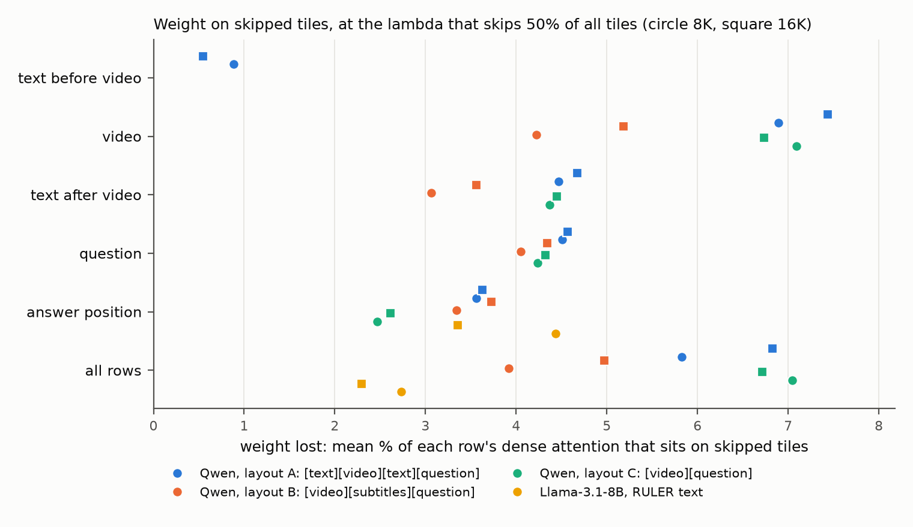

> **In this package:** the data files named below are in `../results/vlm_regions/`, figures in `figures/`, code in `../code/`. Not included (too big, still on DeltaAI): `vlm2_tensors/`, `vlm2_inputs/`. Report copied unchanged from DeltaAI except this line and the figure link.

# VLM regions, batch 2: weight lost, layout check, accuracy pilot (Qwen2.5-VL-7B)

Run Nov 1, 2026 on DeltaAI (GH200). Builds on `VLM_REGIONS.md` (step 1) but stands alone. Every number below
comes from the `v2_*` files in this folder (`/work/nvme/beqg/zyang21/blasst/results/vlm_regions/`); the step-1
files were not changed.

## Takeaways

1. **Weight lost.** Skipping 84% of the text->video tiles removes little attention in absolute terms but about
   half of what is there: text rows after the video put only 4.7-6.5% of their attention on video keys at all,
   and the 50% lambda removes 2.5-3.4 points of it (52-54%). For the answer position it removes 69-72% of a
   2.4-3.3% share. Averaged over all rows, 3.9-7.1% of the attention sits on skipped tiles at 50% skipped
   (layouts A-C), against 2.3-2.7% for Llama-3.1-8B on RULER text, and the tail is long: 13% of question rows
   (per layer and head) lose more than 10%.
2. **Layout check.** The question's view of the video is skipped more than video-to-video in all three layouts,
   but the gap shrinks without a transcript: 38-41 points with the transcript split around the video (layout A),
   32-35 with subtitles after the video (B), 16-17 with no subtitles (C). The weight lost by the question rows
   barely changes (4.0-4.6% of their weight; 39-57% of their video weight).
3. **Accuracy pilot.** 90 Video-MME questions (15 short + 15 medium videos, no subtitles, 128 frames, about 16K
   tokens), prefill with skipping on: dense **65 / 90**, one lambda **61 / 90**, T->V never skipped **64 / 90**,
   both skipping settings at about 46% of tiles skipped live. One lambda turned 4 right answers wrong;
   protecting the question's view of the video (1.6-3.1% of the tiles) turned 1 wrong. That is the direction
   items 1-2 predict, but only 3-4 answers differ, so it is not statistically clear (p = 0.125 and 0.25).

## Words and setup

- **Tile**: 128 query rows x 128 keys. **Skip rule**: skip a tile when every one of its rows has (tile row max -
  running row max) < ln(lambda). **Margin**: the largest of those 128 differences; skipped iff margin < ln(lambda).
  **% skipped** = skipped / causal tiles, over 28 layers x 28 query heads. **Dense** = nothing skipped.
- **The 50% lambda** of a prompt: the one lambda that skips exactly 50% of all its causal tiles (same choice as
  step 1; also 75%). Found from the margins of a dense pass.
- **Weight lost** (item 1): for one (layer, head, query row) the dense softmax weights sum to 100%; the weight
  lost at lambda is the part sitting on tiles that lambda skips. Measured on the dense pass (what skipping would
  remove there). Averages are over layers, heads and rows; "share of rows" counts (layer, head, row) values.
- **Row groups** (by token): *text before video*, *video*, *text after video* (transcript and question),
  *question* (from "Question:" / "Select the best answer" to the end), *answer position* (the last token: its
  output picks the answer letter). Keys are split by token into video keys and other keys.
- **Regions** (item 2, tiles, as in step 1): every 128-token block is text, video or mixed; T->T, T->V, V->T,
  V->V, mixed. Added here: **question->video** = tiles whose query block holds any question token and whose key
  block holds any video token. When the question is short it shares a block with the last video tokens and has
  no pure-text block, so T->V can be empty while question->video is not.
- **Layouts** (Qwen chat template, same 5 long Video-MME videos and first questions as step 1, about 8K and 16K
  tokens):
  - **A** `[transcript part 1][video][transcript part 2][question]` (step 1's prompts, rerun)
  - **B** `[video][subtitles][question]`: Video-MME's "with subtitles" order; the same transcript text (about
    1,700-2,200 text tokens in total), all after the video
  - **C** `[video][question]`: no subtitles (90-143 text tokens); more frames fill the length (62-64 frames at 8K,
    128 at 16K, vs 46-50 / 112-116 in A and B)
  B and C use lmms-eval's Video-MME wording ("Select the best answer ... The best answer is:"); A keeps step 1's.
- **Code**: `blasst_regions.py`, a copy of our tile rule with a per-region lambda table and a "probe" that
  measures weight lost. Tested against `blasst_attn.py` (`test_blasst_regions.py`: identical output and skip count
  with one lambda; per-region decisions equal the offline margins; probe equals a brute-force sum).
  Llama-3.1-8B-Instruct: RULER row 100 of niah_multikey_1/2/3, vt, fwe at 8K and 16K (10 prompts), run the same way.

The 50% lambda per set (median over 5 prompts, range in brackets):

| | 8K, 50% | 8K, 75% | 16K, 50% | 16K, 75% |
|---|---|---|---|---|
| Qwen layout A | 0.151 (0.123-0.225) | 0.89 (0.76-1.0) | 0.097 (0.080-0.145) | 0.51 (0.42-0.64) |
| Qwen layout B | 0.072 (0.069-0.126) | 0.63 (0.54-0.82) | 0.053 (0.043-0.087) | 0.35 (0.28-0.48) |
| Qwen layout C | 0.127 (0.102-0.183) | 0.75 (0.61-0.90) | 0.073 (0.054-0.108) | 0.42 (0.31-0.53) |
| Llama RULER | 0.0130 (0.0120-0.0151) | 0.099 (0.088-0.110) | 0.0052 (0.0044-0.0062) | 0.037 (0.033-0.044) |

Llama's calibrated lambda from the baseline (a / L with a = 106.5) skips 49.0-51.5% of tiles at 8K and
50.9-55.6% at 16K on these prompts; its numbers are reported next to the exact 50% lambda below.

## 1. Attention weight lost (`v2_weight_regions.csv`, `v2_weight_distribution.csv`, `v2_weight_layers.csv`)

**Layout A (step 1's prompts), 50% lambda**, pooled over 5 prompts per length:

| Rows | 8K: weight on video keys (dense) | 8K: video weight lost | 8K: % of video weight removed | 8K: total weight lost | 16K: on video | 16K: lost | 16K: % removed | 16K: total lost |
|---|---|---|---|---|---|---|---|---|
| text after video | 4.66% | 2.50 | 53.6% | 4.47% | 6.47% | 3.38 | 52.3% | 4.67% |
| question | 4.24% | 2.41 | 56.9% | 4.51% | 5.63% | 3.14 | 55.7% | 4.57% |
| answer position | 2.36% | 1.69 | 71.6% | 3.56% | 3.29% | 2.26 | 68.7% | 3.63% |
| video | 43.75% | 5.46 | 12.5% | 6.89% | 48.30% | 6.60 | 13.7% | 7.44% |
| text before video | 0 (cannot see it) | | | 0.89% | 0 | | | 0.54% |
| all rows | 33.29% | 4.40 | 13.2% | 5.83% | 42.64% | 5.98 | 14.0% | 6.83% |

The rest of the text rows' attention (93-96%) goes to text keys, of which they lose 1.3-2.1 points.

**Same at the 75% lambda (layout A):** question rows lose 3.66 of 4.24 points of video weight at 8K (86%) and 4.71
of 5.63 at 16K (84%), 9.1-10.5% of their weight in total; the answer position loses 92-94% of its video weight
(7.5-9.1% in total); video rows lose 19.3-19.8%; all rows 16.8-17.7%.

**Compared with Llama-3.1-8B on RULER text** (mean weight lost per row):

| | 8K, 50% | 16K, 50% | 8K, 75% | 16K, 75% |
|---|---|---|---|---|
| Llama, all rows, exact lambda | 2.74% | 2.29% | 8.82% | 7.47% |
| Llama, all rows, calibrated a / L | 2.84% | 2.74% | 9.22% | 8.61% |
| Llama, answer position, exact lambda | 4.44% | 3.36% | 9.86% | 7.84% |
| Qwen layout A, all rows | 5.83% | 6.83% | 16.81% | 17.72% |
| Qwen layout A, answer position | 3.56% | 3.63% | 9.09% | 7.49% |

**Spread over rows (50% lambda)**: the mean hides a long tail.

| Rows | Median | 90th percentile | 99th percentile | Share losing > 10% |
|---|---|---|---|---|
| Qwen A, question, 8K / 16K | 1.9% / 1.9% | 11.6% / 11.6% | 28.9% / 30.3% | 12.8% / 13.0% |
| Qwen A, answer position | 1.6% / 1.8% | 7.3% / 8.0% | 19.4% / 19.6% | 8.4% / 9.1% |
| Qwen A, video | 2.5% / 2.7% | 19.9% / 22.5% | 47.3% / 51.1% | 22.9% / 24.6% |
| Llama, all rows | 1.1% / 0.9% | 8.4% / 7.2% | 22.0% / 19.0% | 6.6% / 4.7% |
| Llama, answer position | 2.2% / 1.9% | 8.4% / 7.2% | 17.1% / 16.9% | 11.5% / 7.1% |

(Percentiles are the median over the 5 prompts of each prompt's percentile.)

**By layer** (layout A, 50% lambda): the question rows' dense weight on video keys ranges from 1.5% to 8.1% per
layer at 8K (1.8-10.7% at 16K), highest in layers 14, 16 and 19; the video weight they lose ranges from 0.6 to 3.8
points per layer at 8K (1.0-5.4 at 16K). Over all rows, the weight lost per layer ranges 1.4-13.9% at 8K (largest
in layer 5; video rows lose 17.0% there), vs 0.9-5.8% for Llama (largest in layer 1).

**Plain-language takeaway (1):** text rows hardly look at the video in the first place (about 5% of their
attention), so skipping 84% of their video tiles costs them only 2.5-3.4% of their attention. But it is half of
what they do give the video, and close to three quarters for the answer position. Per row, this VLM loses 2-3
times as much attention as Llama text does at the same 50% skipped; it also needs a 12-19 times larger lambda to
get there (layout A).



## 2. Layout check (`v2_layout_regions.csv`)

% of tiles skipped per region at the 50% lambda (share of all causal tiles in brackets), pooled over 5 prompts:

| Region | A 8K | A 16K | B 8K | B 16K | C 8K | C 16K |
|---|---|---|---|---|---|---|
| V->V | 44.3 (55%) | 47.4 (76%) | 39.4 (51%) | 44.5 (74%) | 51.0 (93%) | 50.5 (97%) |
| T->V | 84.9 (17%) | 83.5 (10%) | 74.4 (36%) | 74.6 (22%) | 88.4 (0.6%, 1 prompt) | 87.1 (0.3%, 1 prompt) |
| **question->video** | **85.1** (3.3%) | **85.4** (1.9%) | **74.0** (4.6%) | **76.3** (2.7%) | **67.1** (3.7%) | **67.5** (1.9%) |
| T->T | 32.7 (6.4%) | 29.8 (1.6%) | 27.8 (7.0%) | 25.0 (1.7%) | 5.9 (0.01%, 1 tile) | 3.4 (0.002%, 1 tile) |
| V->T | 39.5 (18%) | 38.3 (11%) | none | none | none | none |
| mixed | 53.9 (3.1%) | 59.8 (1.6%) | 21.0 (6.2%) | 24.7 (3.1%) | 31.9 (6.1%) | 32.0 (3.1%) |

At the 75% lambda: question->video 96.8 / 96.8 (A), 90.5 / 90.4 (B), 86.5 / 86.0 (C) vs V->V 74.7 / 75.3,
71.6 / 73.1, 77.0 / 76.0.

Notes on the table:
- In B and C the video starts right after the system prompt, so the first block is mixed (system prompt plus the
  first video tokens) and V->T does not exist; that block holds the attention sink, which is why "mixed" is
  skipped less there.
- In C the question (50-103 tokens) shares its block with the last video tokens, so only one prompt has a pure
  T->V block; question->video is the comparable number. Its tiles also contain video rows, and a tile is skipped
  only if all its rows agree, which pulls it down.
- Layout A reproduces step 1 within 0.02 points (V->V 44.29 vs 44.27, T->V 84.93 vs 84.92 at 8K).

Weight lost by the question rows (50% lambda), all layouts:

| Layout | Question: weight on video (dense) | Video weight lost | % of it removed | Total weight lost | Answer position: on video / lost / % removed | Video rows: total lost | All rows: total lost |
|---|---|---|---|---|---|---|---|
| A 8K | 4.24% | 2.41 | 56.9% | 4.51% | 2.36% / 1.69 / 71.6% | 6.89% | 5.83% |
| A 16K | 5.63% | 3.14 | 55.7% | 4.57% | 3.29% / 2.26 / 68.7% | 7.44% | 6.83% |
| B 8K | 5.19% | 2.39 | 46.1% | 4.05% | 3.15% / 1.85 / 58.7% | 4.23% | 3.92% |
| B 16K | 6.40% | 3.15 | 49.2% | 4.35% | 4.15% / 2.44 / 58.7% | 5.18% | 4.97% |
| C 8K | 9.77% | 4.21 | 43.1% | 4.24% | 4.54% / 2.38 / 52.5% | 7.09% | 7.05% |
| C 16K | 10.97% | 4.31 | 39.3% | 4.32% | 5.27% / 2.58 / 49.0% | 6.73% | 6.71% |

**Plain-language takeaway (2):** yes, the question's view of the video is still the most skipped part in every
layout, but how much more depends on the layout: with a transcript around the video the gap to video-to-video is
about 40 points, with subtitles after the video about 33, and with the question alone about 16. Without
subtitles the question looks at the video twice as much (10-11% of its attention) and loses about the same share
of its total attention (4.2-4.3%). So the effect is real but partly a product of where text sits in the prompt.

## 3. Accuracy pilot (`v2_pilot.jsonl`, `v2_pilot_summary.csv`)

**Setting.** Layout C (`[video][question]`, no subtitles, lmms-eval wording), about 16K tokens (16,214-16,324),
128 frames at 336 x 588 (one video: 134 frames at 308 x 616), Qwen2.5-VL-7B in bf16. Videos: the first 15 short
(36-111 s) and the first 15 medium (4.4-17.4 min) Video-MME videos in ID order from chunks 1-3, all 3 questions
each = 90 questions. The model's answer is the letter A-D with the highest logit at the last prompt position
(for all 270 runs the model's overall top token was one of those letters). Skipping is on during prefill in every
layer of the language model; the vision encoder is untouched.

**Dense check first.** Shorter videos than step 1's (which were 34-53 min) give more frames per minute of video.
Question 1 of each of the 30 videos, dense: **20 of 30 right** (10 of 15 short, 10 of 15 medium; chance is 7.5).
That passed the bar set before the run (15 of 30), so this was the setting used; no other setting was tried.

**The three settings:**
- **dense**: nothing skipped.
- **one lambda**: each prompt's own lambda that skips 50% of all causal tiles on its dense margins (median
  0.076, range 0.048-0.237).
- **T->V never skipped**: every tile whose query block holds question text and whose key block holds any video
  token is never skipped (the "question->video" tiles of item 2; 1.56% of causal tiles, 3.08% in the 7 prompts
  whose question spans two blocks). One shared lambda for all other tiles, set on the dense margins so the total
  is again 50% (median 0.081, 6-18% larger than the one-lambda value).

**Accuracy, correct answers out of N:**

| Videos | dense | one lambda | T->V never skipped |
|---|---|---|---|
| all 30 (N = 90) | **65 / 90** | **61 / 90** | **64 / 90** |
| 15 short (N = 45) | 36 / 45 | 33 / 45 | 35 / 45 |
| 15 medium (N = 45) | 29 / 45 | 28 / 45 | 29 / 45 |

**Which answers changed** (out of 90):

| Compared with dense | answer changed | right -> wrong | wrong -> right |
|---|---|---|---|
| one lambda | 5 | 4 | 0 |
| T->V never skipped | 3 | 1 | 0 |

- Between the two skipping settings, 3 questions are right with T->V protected and wrong with one lambda, and
  none the other way. The one question lost with T->V protected (165-1) was also lost with one lambda.
- Every changed answer was a close call when dense: the top letter was ahead of the second by 0.0-1.5 logits,
  against a median of 2.25 over all 90 questions.
- 4 of the 5 one-lambda changes are on short videos; 3 of the 4 lost questions are action recognition or
  temporal reasoning.
- With this few changed answers the difference may be chance. If skipping made a right->wrong or wrong->right
  change equally likely, the 4 one-lambda changes that moved the score would all go the same way 1 time in 8
  (two-sided exact sign test, p = 0.125); the 3-to-0 split between the two skipping settings, 1 time in 4
  (p = 0.25).

**% skipped, measured live** (mean over the 90 prompts):

| | all tiles | question->video tiles | V->V tiles |
|---|---|---|---|
| one lambda | 45.8% (43.6-47.2) | 60.2% (50.3-78.1) | 45.5% |
| T->V never skipped | 45.7% (43.5-47.2) | 0% | 46.5% |

The lambdas were chosen to skip 50% on the dense margins, but with skipping on only about 46% of tiles are
skipped. The likely reason (not checked layer by layer): skipping changes what later layers receive, and fewer of
their tiles end up below the threshold. Both
skipping settings still skip the same total, within 0.1 point. So the comparison is fair, but it was made at about
46% skipped, not 50%.

**Plain-language takeaway (3):** dense gets 65 of 90 right. Skipping about 46% of tiles with one lambda costs 4
questions (61 of 90). Keeping the question's view of the video dense, and skipping the same total elsewhere, costs
1 (64 of 90). Protecting those tiles is cheap: they are under 2% of all tiles in most prompts (3% in the rest). The
direction fits items 1 and 2: the question's video tiles are skipped more than the rest, and the answer position
loses about half of its video weight to skipping. But the gap rests on 3 to 4 changed answers out of 90, so it is
a hint, not a result. A clear answer needs several hundred questions or a higher skip level, where more answers
change.

## Cost

Charged GPU-hours for this batch, from `sacct`: **1.26 of the 3 allowed**.

| Job | Partition | Wall time | Charged GPU-hours |
|---|---|---|---|
| 3502018 debugging (items 1-3, small inputs) | `ghx4-interactive` (charge x2) | 3 min 54 s | 0.13 |
| 3502060 items 1-2 (40 prompts x 2 dense passes) | `ghx4` | 12 min 40 s | 0.21 |
| 3502061 item 3 (90 questions x 3 settings, plus model loading) | `ghx4` | 55 min 11 s | 0.92 |

One prefill takes about 11.6 s dense and 11.8-11.9 s with skipping. Our attention function is a plain PyTorch
loop that still computes every tile and then masks the skipped ones, so these times say nothing about speed-up.
Project total so far: about 4.4 GPU-hours (baseline 3.02, step 1 0.13, this batch 1.26).

## Caveats

- 5 videos (all long, 34-53 min), one question each, for items 1-2; 10 Llama RULER prompts for the comparison.
- Weight lost is measured on the dense pass. With skipping on, later layers see slightly different inputs.
- Weight lost says how much attention a row stops seeing, not how much the output changes: the skipped keys'
  values could be close to the kept ones. Item 3 measures the effect on answers.
- B and C change more than one thing at once: where the text sits, the question wording (lmms-eval's), and in C
  the number of frames. The layout effect is therefore not one clean variable.
- The step-1 caveats still apply (dense-pass margins, per-query-head decisions, low frame counts).
- Item 3: 90 questions from only 30 videos (3 questions per video, so not 90 independent samples), one layout
  (C, where the region gap was smallest in item 2), one length (16K), and one skip level that ended up at about
  46% live, not 50%. The lambdas are each prompt's exact value from its own dense pass, not a calibrated a / L
  rule, so a deployed version would also need a rule for choosing lambda. Long videos were not tested for
  accuracy.

## Files and how to re-run

In `/work/nvme/beqg/zyang21/blasst/`: `blasst_regions.py` (attention function), `test_blasst_regions.py`
(CPU tests), `vlm2_prepare.py` (CPU: layouts B, C and the pilot prompts -> `vlm2_inputs/`), `vlm2_weights.py`
(GPU: items 1-2 -> `vlm2_tensors/`, 5.4 GB, per-row weight arrays and margins), `vlm2_pilot.py` (GPU: item 3),
`vlm2_analyze.py` (CPU: every `v2_*` file here), `vlm2_weights.sbatch`, `vlm2_pilot.sbatch`.

```bash
source /work/nvme/beqg/zyang21/blasst/env.sh
python test_blasst_regions.py             # CPU, seconds
python vlm2_prepare.py                    # CPU, about 2 min
sbatch vlm2_weights.sbatch                # items 1-2, about 13 min on ghx4
sbatch vlm2_pilot.sbatch                  # item 3, about 55 min on ghx4 (resumes from v2_pilot.jsonl)
python vlm2_analyze.py                    # CPU, about 2 min
```
